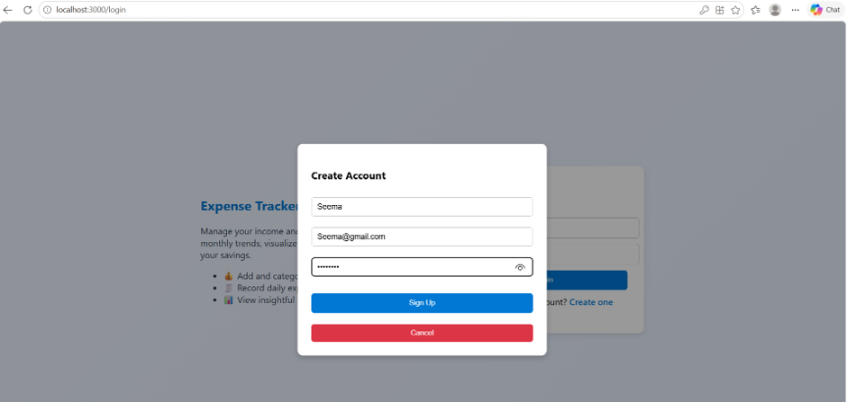
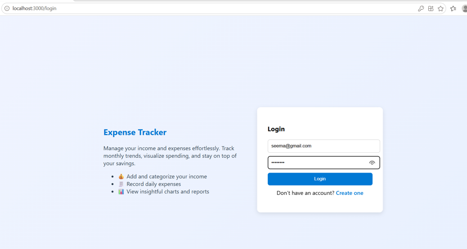
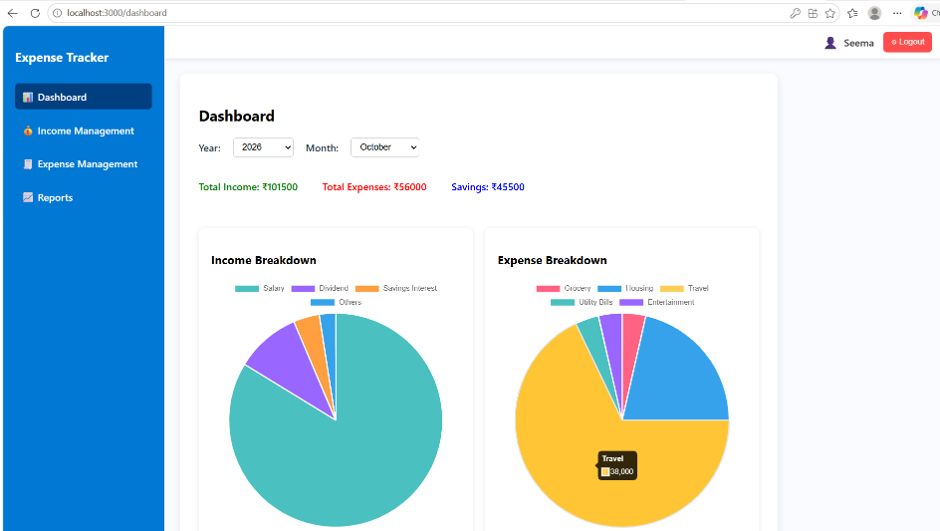
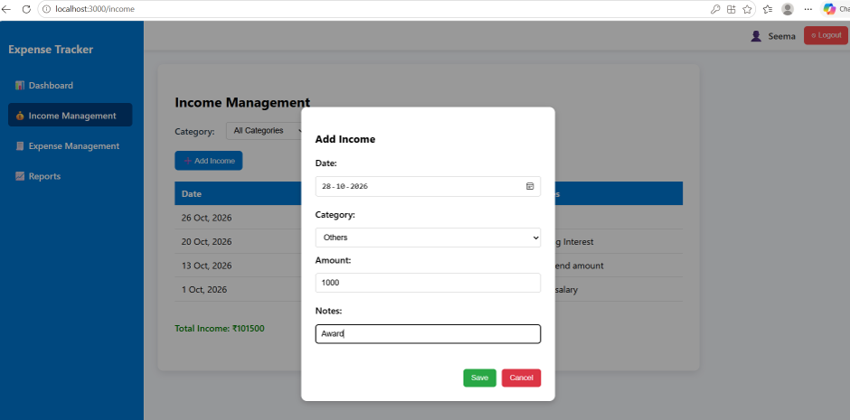
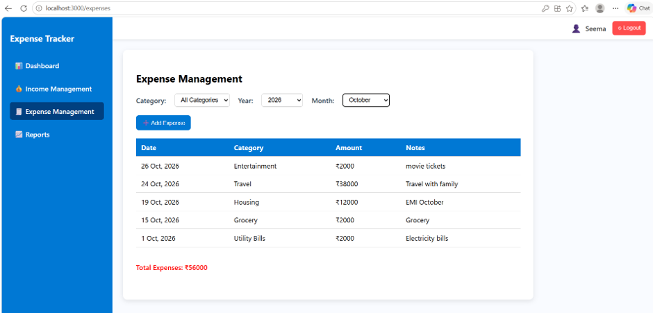
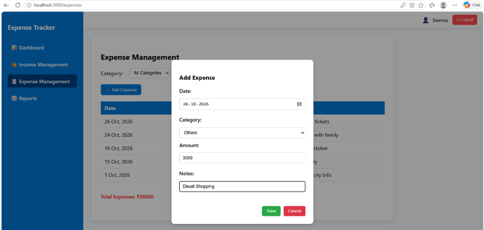
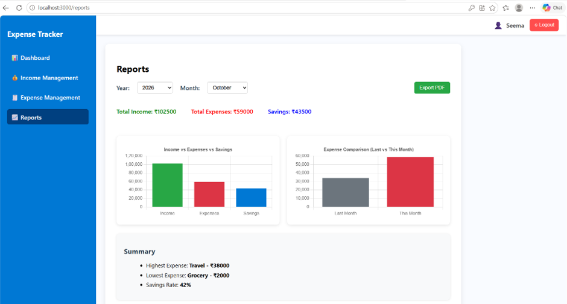
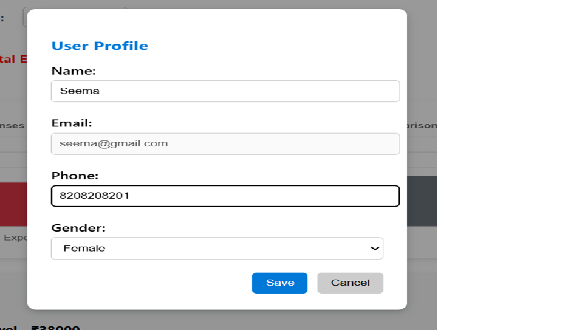

# Expense Tracker Application

## Overview

Expense Tracker is a full-stack web application that helps users manage their income and expenses securely.

The application provides JWT-based authentication, income and expense tracking, validations, exception handling, and reporting capabilities.

---

## Project Features

### User Interface features

#### User Management
- User Registration
- User Login
- Update User profile details

#### Dashboard 
- Yearly/Monthly Income vs Expense Overview

#### Income Management
- Add Income
- View Income by date
- View Income by Category

#### Expense Management
- Add Expense
- View Expense by date
- View Expense by Category

#### Reports
- Yearly/Monthly Income vs Expense Charts.
- Expense comparison with last month.
- Export Report as PDF

### Technical features

#### Security
- Spring Security
- JWT Authentication
- Custom JWT Request Filter
- Protected REST APIs
- BCrypt Password Encryption

#### Validation
- Frontend Validation using React
- Backend Validation using Bean Validation

#### Error Handling
- Global Exception Handling
- Custom Error Responses

#### Logging
- Application-Level Logging using SLF4J

#### Development enhancements
- Lombok for Boilerplate Code Reduction
- Layered Architecture (Controller, Service, Repository)

---

## Technology Stack

### Backend

- Java 21
- Spring Boot
- Spring Security
- JWT
- Hibernate
- JPA
- Lombok
- Maven
- MySQL

### Frontend

- ReactJS
- Axios
- HTML
- CSS
- JavaScript

### Tools

- Git
- GitHub
- Postman
- VS Code
- Spring Tools for Eclipse

---

## Setup Instructions

### Backend Setup

1. Clone the repository
2. Create MySQL database
3. Update application.properties with database credentials & JWT secret key.
4. Run ExpenseTrackerApplication

### Frontend Setup

1. Navigate to expense-tracker-frontend
2. Run:
```bash
npm install
npm start
```
### Application URLs

Frontend: http://localhost:3000

Backend: http://localhost:8090

---

## Application Screenshots

### User Registration



### Login Page



### Dashboard



### Income Management


### Add Income



### Expense Management



### Add Expense



### Reports



### Update User Profile



## Sample Generated Report

[Sample Monthly Report](screenshots/monthly-report.pdf)

---

## Project Structure

### Backend (Spring Boot)

```text
expense-tracker-backend
│
├── src/main/java/com/example/demo
│   ├── config
│   │   ├── JwtFilter
│   │   ├── JwtUtil
│   │   └── SecurityConfig
│   │
│   ├── controller
│   │   ├── AuthController
│   │   ├── IncomeController
│   │   ├── ExpenseController
│   │   ├── CategoryController
│   │   └── UserController
│   │
│   ├── entities
│   │   ├── User
│   │   ├── Income
│   │   ├── Expense
│   │   └── Category
│   │
│   ├── repository
|   |   ├──UserRepository
|   |   ├──IncomeRepository
|   |   ├──ExpenseRepository
|   |   ├──CategoryRepository
│   │
│   ├── service
|   |   ├──AuthService
|   |   ├──UserService
|   |   ├──IncomeService
|   |   ├──ExpenseService
|   |   ├──CategoryService
│   │   
│   ├── exception
│   │   ├──GlobalExceptionHandler
|   |
│   └── ExpenseTrackerApplication
│
└── src/main/resources
    └── application.properties
```
### Frontend (React)

```text
expense-tracker-frontend
│
├── public
│
└── src
    ├── api
    │   └── axios.js
    │
    ├── components
    │   ├── LoginPage
    │   ├── SignupForm
    │   ├── Dashboard
    │   ├── IncomePage
    │   ├── ExpensePage
    │   ├── ReportsPage
    │   ├── UserProfilePopup
    |   ├── AppLayout
    │
    ├── App.js
    └── index.js
```

---

## Database Tables

### users

Stores user information.

### categories

Stores income and expense categories.

### income

Stores user income records.

### expenses

Stores user expense records.

---

## Security Flow

1.User enters email and password on the React login page.
2.Frontend sends login credentials to the Spring Boot authentication API.
3.Backend validates the credentials against the user records stored in the MySQL database.
4.If authentication is successful, the backend generates a JWT token containing the authenticated user's details and token expiration information.
5.Backend returns the JWT token and basic user information to the frontend.
6.Frontend stores the JWT token in Local Storage for subsequent requests.
7.For every protected API request, the frontend automatically includes the JWT token in the Authorization header.
8.JWT Filter intercepts incoming requests before they reach the controller.
9.The filter extracts the token from the request header and validates.
10.If the token is valid, Spring Security creates an authenticated user context and allows the request to proceed.
11.Controller processes the request and returns the response.
12.If the token is missing, invalid, or expired, the backend returns an appropriate error response.
13.On token expiration, the frontend clears the stored token and redirects the user to the login page.

---

## Backend APIs

### Authentication

- POST /api/auth/signup
- POST /api/auth/login

### Income

- GET /api/income/getIncome/user/{userId}
- POST /api/income/addIncome
- DELETE /api/income/deleteIncome/user/{userId}/income/{incomeId}

### Expense

- GET /api/expenses/getExpenses/user/{userId}
- POST /api/expenses/addExpense
- DELETE /api/expenses/deleteExpense/user/{userId}/expense/{expenseId}

### Categories
- GET /api/categories/all
- GET /api/categories/getCategoryByType/{type}

### User update
- PUT /api/user/update/{userId}

---

## Future Enhancements

- Refresh token implementation
- DTO layer implementation
- Role-Based Access Control (RBAC) for administrative operations.
- Password reset functionality
- Pagination and sorting
- Junit test cases
- Docker Containerization
- CI/CD Pipeline Integration

---

## Documentation

- Database Design Document
- Entity Relationship (ER) Diagram
- JWT Authentication Test Cases
- Validation Test Cases

Available under the `documents` folder.

---

## Author

KanchanmB
Java Full Stack Developer

GitHub:
https://github.com/kanchanmb01
